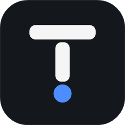
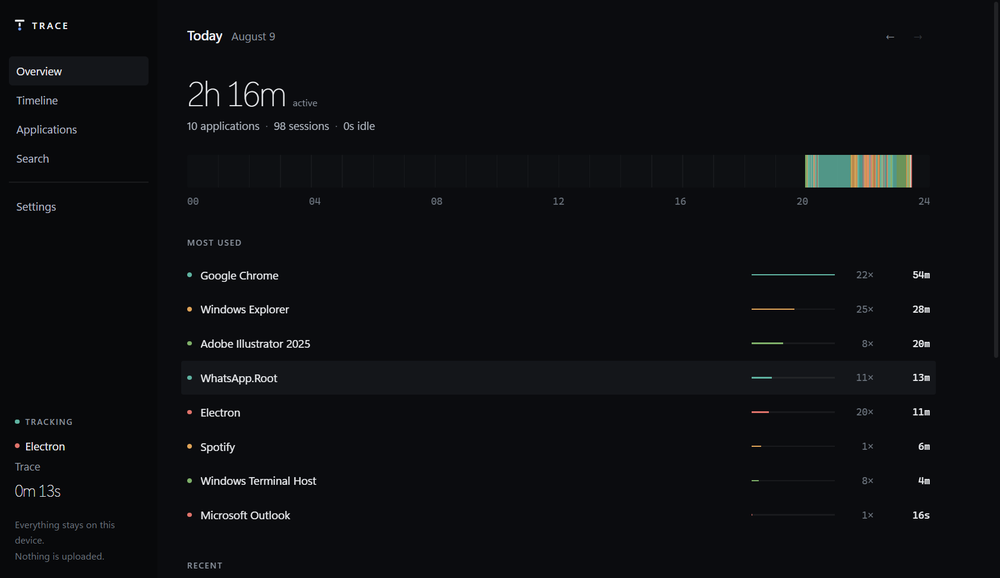
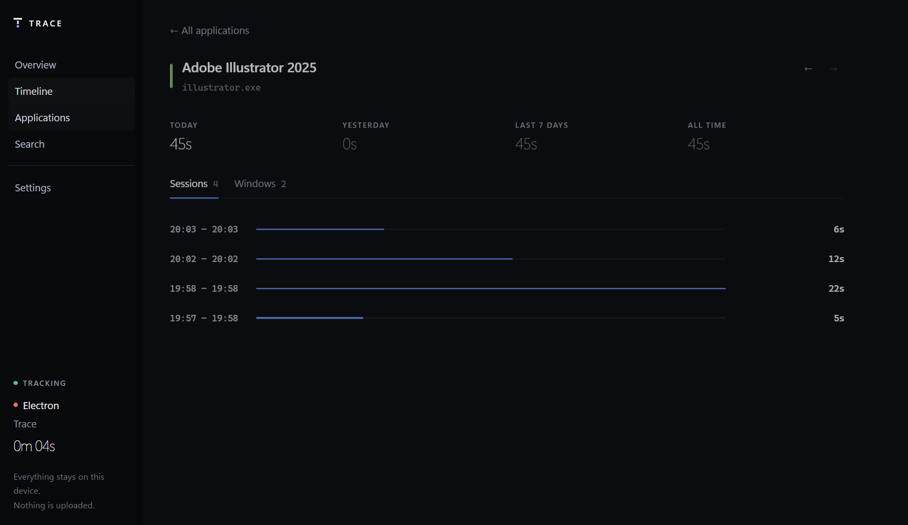

<div align="center">



# Trace

**Your computer, remembered.**

A private, local activity history for Windows. Trace quietly records which
applications you use and when, and gives you a searchable history of your day.

Nothing leaves your machine. There is no account, no server, and no telemetry.

<br>



</div>

---

## Why

Screen-time tools tell you that you spent two hours in Chrome. That is rarely
the question you actually have.

The question is usually *"what was I doing at seven last night?"* — and
answering it means keeping the shape of the day, not a daily total. Trace stores
every session with its start, its end, and what was on screen, so the day can be
reconstructed rather than summarised.

```
09:00  Chrome     YouTube            20m
09:20  VS Code    project-x          40m
10:00  Chrome     GitHub             40m
10:30  Chrome     ·  10m idle
11:00  Computer locked
11:30  Computer unlocked
```

## Privacy is the architecture, not a setting

Trace is a historian, not a surveillance tool. It records *that* something
happened, never the private content of it.

**Never collected — there is no code in this repository that could:**

| | | |
|---|---|---|
| Keystrokes | Passwords | Clipboard contents |
| Screenshots | Microphone | Webcam |
| File contents | Browsing history | Message contents |

There are no keyboard or mouse hooks, no screen capture, no DLL injection, and
no browser integration. Idle detection asks Windows a single question — *how
long since the last input?* — and receives a number, never a keystroke.

Three properties hold structurally rather than by policy:

- **Filtering happens before persistence.** An excluded application produces no
  session, no window title and no event. It is not recorded and then hidden — it
  is never written. The engine physically cannot reach storage except through
  `PrivacyGate`.
- **Pausing is real, and it survives a restart.** While paused, nothing is
  written and nothing is buffered for later. If you paused it, it is still
  paused after a reboot.
- **Deleting deletes.** The schema has no soft-delete column, so "hidden but
  retained" is not representable.

## What it does

**Tracking** — foreground application and window, sessions with real
start/end times, idle detection, lock/unlock, sleep/wake, and recovery from
crashes and power loss.

**History** — a day ribbon showing the shape of your day, a timeline you can
read top to bottom, per-application detail, and search across every recorded
title.

**Control** — pause, per-application exclusions, a window-title switch, data
retention, JSON export, and deletion by range or in full.

<div align="center">

</div>

## How it works

Two processes. The dashboard is optional; the tracker is the product.

```
        Windows APIs
             │  foreground · idle · lock · sleep
             ▼
   ┌─────────────────────┐
   │  TraceTracker.exe   │   background, owns the tray
   │                     │
   │  watchers → queue → engine → PrivacyGate → SQLite
   └──────────┬──────────┘
              │  \\.\pipe\Trace.<SID>   (per-user DACL, NDJSON)
              ▼
   ┌─────────────────────┐
   │      Trace.exe      │   Electron · React · TypeScript
   └─────────────────────┘
```

- **The tracker outlives the window.** Close the dashboard and recording
  continues; it is a separate process that owns the tray icon, so pausing works
  even if the interface has crashed or was never opened.
- **The tracker is the only writer.** The interface never opens the database.
  Every duration, count and total arrives already computed, so two screens
  cannot disagree about how long you used something.
- **A named pipe, not a local HTTP port.** A TCP listener is reachable by every
  process on the machine and by pages in your browser. The pipe's ACL admits
  only your own account.
- **It never invents activity.** When the machine dies mid-session, the session
  is closed at the last heartbeat and marked interrupted — undercounting rather
  than guessing.

## Install

Download `Trace-Setup-<version>.exe` and run it.

Per-user install, so there is **no administrator prompt**. Everything lives
under your own account:

| | |
|---|---|
| Application | `%LOCALAPPDATA%\Programs\Trace` |
| Your history | `%LOCALAPPDATA%\Trace\Data\activity.db` |

Uninstalling asks what to do with your history rather than deciding for you.

## Build from source

**Requirements** — Windows 10 1809 or later, [.NET 10 SDK], [Node.js] 20.19+.

```bash
git clone git@github.com:leviGatimu/Trace.git
cd Trace
npm install
```

Build the installer — brand assets, tracker, both test suites, dashboard,
package. The result lands in `installer/`:

```bash
npm run installer
```

### Development

```bash
# Tracker — start it first; the dashboard is a client
dotnet run --project apps/tracker/Trace.Tracker

TraceTracker.exe --diagnose   # live Win32 + engine trace, writes nothing
TraceTracker.exe --dump       # print the recorded history, read-only
TraceTracker.exe --probe      # exercise the IPC contract against a running tracker

# Dashboard
cd apps/desktop
npm run dev

# Website, at http://localhost:3000
npm run dev:website
```

Tests:

```bash
dotnet test apps/tracker/Trace.Tracker.Tests   # 80 — engine, persistence, IPC, privacy
npm test --workspace=apps/desktop              # 24 — formatting and interface
```

## Layout

```
apps/
  tracker/        TraceTracker.exe — C# · Win32 · SQLite
    Windows/        the only place P/Invoke lives
    Engine/         the session state machine, no Windows or database in it
    Privacy/        PrivacyGate — the only route from engine to storage
    Data/           schema, migrations, repositories, read models
    Ipc/            named-pipe server and request router
  desktop/        Trace.exe — Electron · React · TypeScript · Tailwind
  website/        the marketing site — Next.js · React · Tailwind
packages/
  contracts/      the UI ↔ tracker contract: spec, TypeScript, C# mirror
tools/
  Trace.IconForge/  the logo, generated from code
DOCS/             product documentation and the implementation plan
```

## Design

Dark, dense and typographic. No cards and no boxes — sections are separated by
space and a label, lists by alignment. Times and durations are monospaced so
columns can be compared without being read.

The signature is the **day ribbon**: twenty-four hours as one continuous band,
each session a segment in its application's colour, gaps left as gaps. A chart
of hourly totals answers *how much*; the ribbon answers *when*, which is the
question a recorder exists to answer.

Application colours are hashed from the executable name, so an application is
the same colour everywhere, permanently, without anything being stored.

## Status

The MVP is complete and works end to end. Hardening — long soak, sleep/wake
cycles, large histories, multiple Windows accounts — is next, followed by the
V2 scope in [`DOCS/MVPV2.md`](DOCS/MVPV2.md): calendar navigation, analytics,
categories, notes and reports.

[`DOCS/IMPLEMENTATION-PLAN.md`](DOCS/IMPLEMENTATION-PLAN.md) records every
technical decision and, more usefully, the ones that were rejected and why.

[.NET 10 SDK]: https://dotnet.microsoft.com/download
[Node.js]: https://nodejs.org
