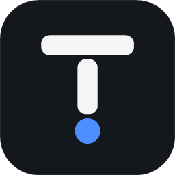
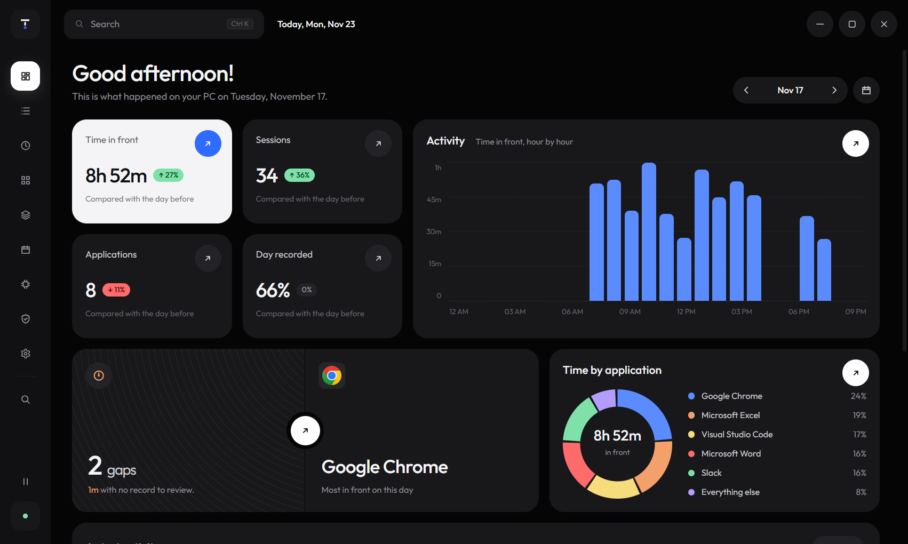
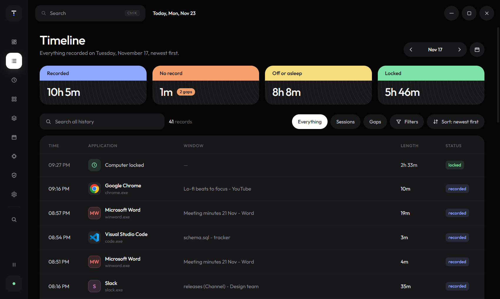
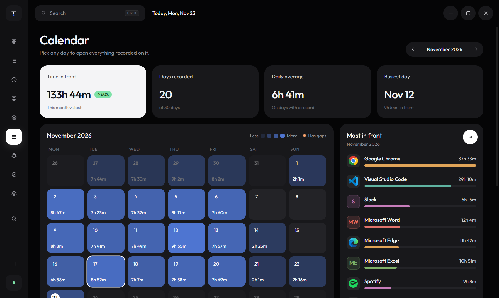
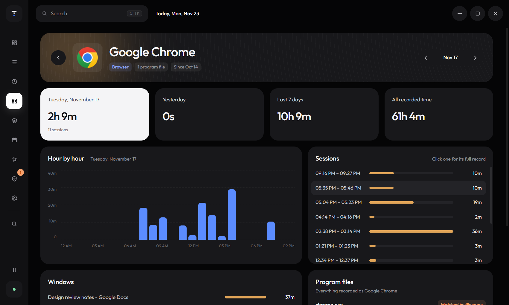
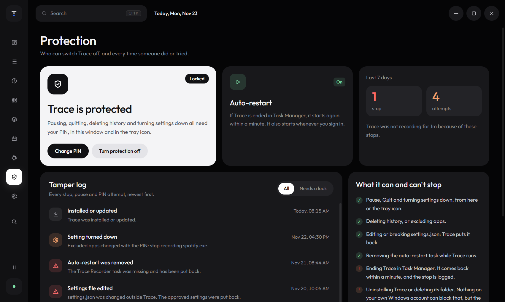

<div align="center">



# Trace

**Your computer, remembered.**

A private, local activity history for Windows. Trace quietly records which
applications you use and when, and gives you a searchable history of your day.

Nothing leaves your machine. There is no account, no server, and no telemetry.

<br>



</div>

---

## Why

Screen-time tools tell you that you spent two hours in Chrome. That is rarely
the question you actually have.

The question is usually *"what was I doing at seven last night?"* — and
answering it means keeping the shape of the day, not a daily total. Trace stores
every session with its start, its end, and what was on screen, so the day can be
reconstructed rather than summarised.

```
09:00  Chrome     YouTube            20m
09:20  VS Code    project-x          40m
10:00  Chrome     GitHub             40m
10:30  Chrome     ·  10m idle
11:00  Computer locked
11:30  Computer unlocked
```

## Privacy is the architecture, not a setting

Trace is a historian, not a surveillance tool. It records *that* something
happened, never the private content of it.

**Never collected — there is no code in this repository that could:**

| | | |
|---|---|---|
| Keystrokes | Passwords | Clipboard contents |
| Screenshots | Microphone | Webcam |
| File contents | Browsing history | Message contents |
| Command lines | Mouse movements | Network traffic |

There are no keyboard or mouse hooks, no screen capture, no DLL injection, and
no browser integration. Idle detection asks Windows a single question — *how
long since the last input?* — and receives a number, never a keystroke.

Three properties hold structurally rather than by policy:

- **Filtering happens before persistence.** An excluded application produces no
  session, no window title and no event. It is not recorded and then hidden — it
  is never written. The engine physically cannot reach storage except through
  `PrivacyGate`.
- **Pausing is real, and it survives a restart.** While paused, nothing is
  written and nothing is buffered for later. If you paused it, it is still
  paused after a reboot.
- **Deleting deletes.** The schema has no soft-delete column, so "hidden but
  retained" is not representable.

## What it does

**Tracking** — foreground application and window, sessions with real
start/end times, idle detection, lock/unlock, sleep/wake, and recovery from
crashes and power loss. Applications are named the way Windows names them
(registry, package manifest, version info), not by their file name.

**History** — an overview of the day, a timeline you can read top to bottom
(or filter to just the gaps), a calendar, per-application detail across a day,
week, month or year, and search across every recorded title.

**Windows records** — when the computer started, shut down, slept, woke and was
signed in, read from the Windows event log, so the gaps in a day explain
themselves.

**Background apps** *(opt-in)* — which of your own programs ran without a
window, and for how long. Process names only, never command lines.

**System** — live processor, graphics and memory use. Shown, never stored.

**Protection** — a separate Trace PIN for pausing, quitting, weakening privacy
settings or deleting history; a visible scheduled task that restarts the
recorder if it is ended; and a tamper log of every stop, update and repair.
It makes switching Trace off hard and always visible, not impossible: nothing
about it is hidden from you.

**Control** — pause, per-application exclusions, a window-title switch, data
retention, JSON export, and deletion by range or in full.

<table>
<tr>
<td></td>
<td></td>
</tr>
<tr>
<td></td>
<td></td>
</tr>
</table>

Every screen, on made-up demo history: [`DOCS/README.md`](DOCS/README.md#screens).

## How it works

Two processes. The dashboard is optional; the tracker is the product.

```
        Windows APIs
             │  foreground · idle · lock · sleep
             ▼
   ┌─────────────────────┐
   │  TraceTracker.exe   │   background, owns the tray
   │                     │
   │  watchers → queue → engine → PrivacyGate → SQLite
   │  identity · processes · protection · tray
   └──────────┬──────────┘
              │  \\.\pipe\Trace.<SID>   (per-user DACL, NDJSON)
              ▼
   ┌─────────────────────┐
   │      Trace.exe      │   Electron · React · TypeScript
   └─────────────────────┘
```

- **The tracker outlives the window.** Close the dashboard and recording
  continues; it is a separate process that owns the tray icon, so pausing works
  even if the interface has crashed or was never opened.
- **The tracker is the only writer.** The interface never opens the database.
  Every duration, count and total arrives already computed, so two screens
  cannot disagree about how long you used something.
- **A named pipe, not a local HTTP port.** A TCP listener is reachable by every
  process on the machine and by pages in your browser. The pipe's ACL admits
  only your own account.
- **It never invents activity.** When the machine dies mid-session, the session
  is closed at the last heartbeat and marked interrupted — undercounting rather
  than guessing.

## Install

Download `Trace-Setup-<version>.exe` and run it.

Per-user install, so there is **no administrator prompt**. Everything lives
under your own account:

| | |
|---|---|
| Application | `%LOCALAPPDATA%\Programs\Trace` |
| Your history | `%LOCALAPPDATA%\Trace\Data\activity.db` |

Updating installs over the top and keeps your history. Uninstalling asks what
to do with your history rather than deciding for you.

## Build from source

**Requirements** — Windows 10 1809 or later, [.NET 10 SDK], [Node.js] 20.19+.

```bash
git clone git@github.com:leviGatimu/Trace.git
cd Trace
npm install
```

Build the installer — brand assets, tracker, both test suites, dashboard,
package. The result lands in `installer/`:

```bash
npm run installer
```

### Development

```bash
# Tracker — start it first; the dashboard is a client
dotnet run --project apps/tracker/Trace.Tracker

TraceTracker.exe --diagnose   # live Win32 + engine trace, writes nothing
TraceTracker.exe --dump       # print the recorded history, read-only
TraceTracker.exe --probe      # exercise the IPC contract against a running tracker

# Dashboard
cd apps/desktop
npm run dev

# Website, at http://localhost:3000
npm run dev:website
```

Tests:

```bash
npm run test:tracker   # 180 — engine, persistence, IPC, privacy, identity, protection
npm test               # 35 — formatting and interface
npm run typecheck
```

Never point a development tracker at your real history. Set `TRACE_SANDBOX`
to a folder and the tracker, its pipe and the dashboard all use that folder
instead of `%LOCALAPPDATA%\Trace`.

## Layout

```
apps/
  tracker/        TraceTracker.exe — C# · Win32 · SQLite
    Windows/        the only place P/Invoke lives
    Engine/         the session state machine, no Windows or database in it
    Privacy/        PrivacyGate — the only route from engine to storage
    Identity/       application names from registry, packages, version info
    Processes/      background apps (opt-in)
    Protection/     PIN, guarded settings, tamper log
    Data/           schema, migrations, repositories, read models
    Ipc/            named-pipe server and request router
    Tray/           tray icon, menu and PIN prompt
  desktop/        Trace.exe — Electron · React · TypeScript · Tailwind
  website/        the marketing site — Next.js · React · Tailwind
packages/
  contracts/      the UI ↔ tracker contract: spec, TypeScript, C# mirror
tools/
  Trace.IconForge/  the logo, generated from code
DOCS/             concept note, SRS and plan (PDF), specs, screenshots — see DOCS/README.md
```

## Design

Dark and bold: black cards, big numbers, and a few words each. Times and
durations are monospaced so columns can be compared without being read.

Application colours are hashed from the executable name, so an application is
the same colour everywhere, permanently, without anything being stored.

## Status

**0.3.0.** The MVP, the V2 calendar and analytics, application identity,
Windows records, background apps, the System page and tamper protection all
work end to end.

Next, from the [implementation plan](DOCS/pdf/Trace-Implementation-Plan.pdf):
prove and publish 0.3, an endurance run (long soak, sleep/wake cycles, large
histories, multiple Windows accounts), then recent files and findings on the
way to 1.0.

| Read | For |
|---|---|
| [Concept note](DOCS/pdf/Trace-Concept-Note.pdf) | Why Trace exists and what it does |
| [Requirements (SRS)](DOCS/pdf/Trace-SRS.pdf) | Every requirement, numbered |
| [Implementation plan](DOCS/pdf/Trace-Implementation-Plan.pdf) | The phases to 1.0 |
| [Technical decisions](DOCS/engineering/technical-implementation-plan.md) | Every technical choice, and the rejected ones with reasons |

[.NET 10 SDK]: https://dotnet.microsoft.com/download
[Node.js]: https://nodejs.org
